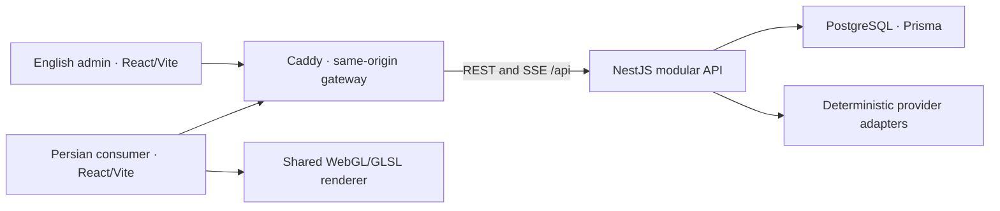

# Architecture

TorobTicket is a comparison and referral product. The browser presents journeys;
the API owns the facts that make two offers comparable and a referral valid.
Provider inventory, prices, availability and account authentication are authored
for this local demonstration. There is no runtime LLM, live provider connection,
payment or booking service.

## One origin, one domain authority

`pnpm docker:up` builds both frontends inside Docker and starts the gateway, API
and PostgreSQL. A one-shot initializer applies migrations and insert-only seeds;
readiness waits for it. `/` serves the consumer, `/admin/` the admin, `/api/` the
API, and `/provider-demo/:id` the retained local receipt route. Shutdown preserves
data; explicit project reset is separate. Development uses the same origin with
containerized Vite and a TypeScript API watcher. See [run locally](run-locally.md).

The selected **Option A** is Nx/pnpm/strict TypeScript, two React/Vite SPAs,
React Router, TanStack Query, typed interaction reducers, NestJS, PostgreSQL and
Prisma. The considered Next.js consumer option would add rendering/server
boundaries for discovery-page SEO, which is outside this release. This choice
is recorded in the [specification](superpowers/specs/2026-10-24-torobticket-design.md#11-architecture-and-alternatives).

## Enforced library boundaries

| Library | Responsibility |
| --- | --- |
| `contracts` | Runtime schemas and public DTO types; no persistence models |
| `domain` | Pure money, time, eligibility, grouping, ranking and hotel rules |
| `fixtures` | Versioned authored inventory and explicit scenario policies |
| `provider-adapters` | Provider dialect validation, normalization and provenance |
| `data-access` | Session-scoped repositories, transactions and immutable evidence |
| `client` | Browser transports, validated snapshots and stream recovery |
| `ui` | Semantic controls, tokens, RTL presentation and finite motion |
| `graphics` | Shared graphics host, GPU simulation, route geometry and fallbacks |

The `web`, `admin` and `api` projects consume these boundaries. Nx ESLint tags
prevent browser libraries from importing server/database/provider code; the pure
domain does not depend on React, Nest or Prisma. See [foundation](decisions/0001-foundation.md).

## From source record to comparable journey

1. A search freezes its session, fixture, mapping and scenario authority. Bounded
   provider work produces genuinely different source dialects and delivery delays.
2. Adapters validate and normalize each record, retaining raw identity, source
   values, mapping decisions and rejected/ambiguous records.
3. The domain groups equivalent ordered services independently of seller IDs.
   Fare eligibility requires explicit source evidence and known mandatory totals;
   unknown conditions do not satisfy affirmative filters.
4. Complete round trips come from one provider's supplied outbound and return
   offer. The legs may use different stops, operators and facilities. The API
   never invents a round trip by adding unrelated sellers' one-way fares.
5. Ranking compares price, elapsed travel or stops/vehicle changes with stable
   tie-breaks. Elapsed time includes connections but excludes the destination stay.
   The date explorer projects the same eligible inventory, not a price forecast.

Integer IRR is the money authority; the consumer formats toman. Whole-party or
whole-stay totals, quote versions, source revisions and unknown terms remain
attached to the evidence. [Comparison](decisions/T07-comparison-and-fare-evidence.md),
[ranking](decisions/T08-ranking-facts-and-suggestions.md),
[date prices](decisions/T10-date-price-projection-and-cache.md).

## Durable evidence, bounded work

REST creates and refines searches. SSE carries ordered per-search IDs and
validated snapshots from the persisted log. An atomic snapshot/cursor recovers
gaps; bounded reconnect attempts fall back to polling. Client generation and
interaction leases reject late work from another search, date edit, dialog or
session. Completion closes stream resources.

PostgreSQL retains raw records, normalization traces, offers, quote versions,
search projections and audit events. This supports reconnect and inspection;
it is not a distributed event-sourcing platform. On restart, completed evidence
survives and unfinished searches become **interrupted**. Explicit retry/admin
replay creates a new search linked to its predecessor; the traveler’s fresh
comparison is a distinct action. Two provider workers per search and bounded
session admission keep the authored workload finite.
[Orchestration](decisions/T09-durable-search-orchestration.md),
[persistence](decisions/T04-session-persistence.md).

A fixture version, seed and frozen anchor reproduce schedule content; actual
event times and expiry use a separate real clock.

The opaque same-origin cookie selects a server-side reviewer namespace. Provider
controls, mappings, searches, identity and referrals are isolated by that scope;
admin metrics derive from its real events. A reset clears only its owned scope.
The local account flow is not external OAuth or production identity management.

## Recheck, consent and handoff

Selecting a seller prepares a fresh quote version. A material change exposes the
old and new facts and requires explicit acceptance. Confirmation validates the
intent, current authority, exact accepted version and expiry in a transaction;
a session/idempotency key returns one immutable receipt. Read-only receipt
refresh does not add traffic. Current actions open the authenticated same-origin
`/api/v1/referrals/:id/outbound` route in a new tab. It records an idempotent
redirect-issued operation, then redirects only to the owner’s `https://zarei.xyz/`
placeholder. This is neither a real provider integration nor proof of page load
or purchase. [Referral authority](decisions/T11-referral-recheck-and-handoff.md).

Hotel discovery binds to the selected outbound arrival facility and its local
arrival date, always one night. Real OSM property names/coordinates are separate
from authored room/rate inventory. The four sorts, capacity and map/card selection
share one guarded query owner. Distances are straight-line. The optional local
MapLibre SDK requests external OSM basemap content; local cards and coordinate
entry remain usable if it fails. [Hotel authority](decisions/0061-arrival-based-hotel-discovery.md),
[real property source](../libs/fixtures/src/catalog/real-hotel-directory.README.md),
[authored room/rate generator](../libs/fixtures/src/real-hotel-inventory.ts).

## Provider traffic and referral fees

The default admin view is **Traffic**. Accepted-offer confirmation and outbound
navigation are separate evidence: a popup can be blocked after confirmation.
`OutboundReferral` records one redirect operation per reviewer workspace and
confirmed receipt. The authenticated GET validates the same-scope immutable
receipt, derives provider/type from it and issues a server-owned destination.
Client-supplied provider, destination, rate and timestamp cannot alter that
operation. HEAD, receipt reads and replay of the same redirect do not create a
new operation or fee. Redirect responses use no-store and no-referrer headers.

Server-minted anonymous browser visitor cookies are signed with an independent,
durable private random secret and bound to the reviewer namespace. Namespace-
specific cookie names fence late responses from old reset scopes. Ordinary
request authentication verifies without writing cookies. Explicit bootstrap
restores visitor state for a live workspace without rotating its auth credential.
New-workspace/reset responses preserve their intentional auth rotation and append
the visitor cookie rather than overwriting the authentication Set-Cookie value.
Browser-session lifetime follows existing auth, with server expiry/revocation
as its bound. Signing in or out does not create a new visitor. Different
browser visitors may be counted within one authorized workspace, while separate
reviewer workspaces never aggregate. This is not person fingerprinting or
production multi-tenant authorization.

Within the scoped transaction lock, the real server clock records the redirect,
checks the visitor/provider's last billable event and assigns an eligible event
its per-provider Persian-month ordinal. Eligibility is a rolling 60 minutes,
including across month boundaries; nonbillable repeats do not slide its anchor.
The same receipt remains idempotent even after the hour. Graduated pricing uses
only the rate for that new ordinal: default checkpoints are 100 and 1,000,
followed by an unbounded tier. Persian month boundaries use Asia/Tehran, reset
counters and preserve the ledger. Tariff revisions, tier and nullable integer-IRR
rate are frozen on each qualified event. Future tariff changes cannot reprice
known or unpriced history. Admin formats exact toman values and distinguishes
an unset rate from a deliberate zero.

The traffic contract applies the same month/date/provider/type filters to totals,
provider rows, daily counts and event pages. Daily bins stop at server-current
Tehran time rather than implying future traffic. The server supplies selected
and current month keys. Current-month checkpoint progress uses all billable
types for that provider; closed months show recorded counts and fees without
predicting a rate from today's tariff. The older **Referrals** route remains an
accepted-receipt/recheck/source audit, not a substitute outbound counter.
No rates are invented, and recorded fees are not provider invoices, settled
payments or purchase conversions. [Decision0086](decisions/0086-provider-traffic-and-graduated-referral-fees.md).

## Graphics enhance semantic content

Three.js/React Three Fiber/Drei and GLSL render the shared desktop travel map,
GPU particle motion, route morphs and directional vehicles. One shared host owns
quality, animation, context recovery and measured bloom qualification. Camera
and display geometry never rewrite timetable facts. HTML controls, ticket cards
and the route timeline remain authoritative; reduced motion, absent WebGL and
small screens retain usable comparisons. The optional hotel street map has a
separate on-demand lifecycle.

[Measured rendering evidence](evidence/release/performance.md) records actual
hardware, byte budgets and limitations. [Limitations](limitations.md) distinguishes
these checks from production scale, physical-device proof and live integrations.
